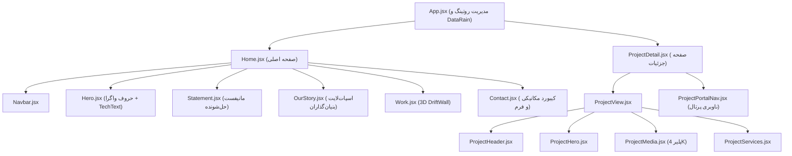

# 🏛️ راهنمای جامع معماری نرم‌افزار و توسعه استودیو رُک (Rok Studio Architecture Guide)

> **نسخه معماری:** `0.16.0`  
> **استک فنی:** React 19, Vite, Tailwind CSS, Framer Motion, Web Audio API  
> **پالت اختصاصی:** مشکی سایبری عمیق (`#050508`) و فیروزه‌ای الکتریک نئونی (`#67E8F9`)

---

## ۱. 📁 ساختار پوشه‌بندی و معماری پروژه

پروژه استودیو رُک بر مبنای **معماری ماژولار و مبتنی بر ویژگی (Feature-Driven & Clean Component Architecture)** سازمان‌دهی شده است. به جای قرار دادن تمام کامپوننت‌ها در یک پوشه شلوغ، هر بخش بزرگ (Feature) دارای زیرپوشه اختصاصی، کامپوننت‌های فرعی، هوک‌ها و داده‌های مربوط به خود است تا خوانایی و قابلیت توسعه به حداکثر برسد.

```
Rock-Studio/
├── src/
│   ├── assets/                 # است‌های بهینه، تصاویر مدرن WebP و کلیپ‌های MP4
│   │   └── projects/           # تصاویر باکیفیت پروژه‌ها و کاشی‌های سبک ۷۰۰ پیکسلی اسکرول
│   │
│   ├── components/
│   │   ├── common/             # ابزارهای عمومی مشترک میان روت‌ها (مانند ScrollToTop)
│   │   ├── layouts/            # پوسته‌های سراسری سایت (مانند Navbar چسبان و دراور موبایل)
│   │   ├── ui/                 # افکت‌های پایه‌ای کانواس و شیدرها (باران داده دیجیتال DataRain)
│   │   └── features/           # ماژول‌های تفکیک‌شده بخش‌های اصلی سایت
│   │       ├── Hero/           # سکشن ورودی، واگرایی حروف ScatterLetter و متن سایبری TechText
│   │       ├── Statement/      # بیانیه مانیفست با افکت محو و آشکار شدن کاراکتر به کاراکتر
│   │       ├── Story/          # عکاسی آنالوگ و اسپات‌لایت تعاملی ۳ هم‌بنیان‌گذار
│   │       ├── Work/           # دیواره سه‌بعدی DriftWall و ناوبری شناور پرتال ProjectPortalNav
│   │       ├── Contact/        # کیبورد مکانیکی سه‌بعدی، سنتز صدا با Web Audio و فرم پیام
│   │       └── ProjectDetail/  # اجزای کیس‌استادی (Header, Hero, Media, Services, View)
│   │
│   ├── data/                   # منابع متمرکز داده و اطلاعات متنی سایت
│   │   ├── projects.js         # لیست تمام پروژه‌های پورتفولیو و متادیتای بنتو گرید
│   │   └── founders.js         # اطلاعات ۳ هم‌بنیان‌گذار، نقل‌قول‌ها و مختصات اسپات‌لایت
│   │
│   ├── hooks/                  # هوک‌های سفارشی ری‌اکت
│   │   └── useMobile.js        # هوک سراسری و ایمن برای تشخیص سایز موبایل (SSR-Safe)
│   │
│   ├── lib/                    # کتابخانه‌ها، توکن‌های سراسری و پیش‌بارگذارها
│   │   ├── constants.js        # توکن‌های دیزاین، پالت رنگ، منحنی‌های Easing، لینک‌های سوشال
│   │   ├── preloadImages.js    # سیستم پیش‌بارگذاری هوشمند تصاویر در بک‌گراند
│   │   └── utils.js            # ابزارهای کمکی ادغام کلاس‌های تیل‌ویند (cn)
│   │
│   ├── pages/                  # صفحات اصلی روتینگ برنامه
│   │   ├── Home.jsx            # ارکستراتور صفحه اصلی پورتفولیو
│   │   └── ProjectDetail.jsx   # کانتینر صفحه پروژه با انیمیشن زوم تمام‌صفحه
│   │
│   ├── App.jsx                 # ریشه برنامه، پیکربندی مسیرها و لایه‌های پس‌زمینه
│   ├── main.jsx                # نقطه ورود React و اتصال به DOM
│   └── index.css               # استایل‌های سراسری، دستورات Tailwind و فونت‌ها
│
├── ARCHITECTURE.md             # همین مستند (راهنمای فنی مهندسی نرم‌افزار)
├── DESIGN_SYSTEM.md            # مستند جامع دیزاین سیستم و هویت بصری
├── vercel.json                 # تنظیمات کش CDN دائم و ریرایت SPA
└── package.json                # اسکریپت‌ها و وابستگی‌های پروژه
```

---

## ۲. 🎨 توکن‌ها و متغیرهای متمرکز (`src/lib/constants.js`)

برای جلوگیری از تکرار کدهای رنگ هاردکدشده (Hardcoded) و تسهیل تغییرات سراسری در آینده، تمامی مقادیر ثابت در `src/lib/constants.js` متمرکز شده‌اند:

```javascript
import { THEME, EASINGS, SOCIAL_LINKS, BREAKPOINTS } from "@/lib/constants";
```

- **رنگ اصلی (Primary Cyan):** `#67E8F9` (آبی فیروزه‌ای نئونی رُک)
- **رنگ پس‌زمینه (Deep Obsidian):** `#050508` (مشکی سایبری مات)
- **منحنی اکسپوننشیال (`EASINGS.expoOut`):** `[0.16, 1, 0.3, 1]` برای ورودهای فوق‌سریع و توقف‌های نرم
- **منحنی سینماتیک (`EASINGS.cinematic`):** `[0.22, 1, 0.36, 1]` برای ترنزیشن‌های عمیق اسکرول
- **لینک‌های شبکه‌های اجتماعی:** مقادیر کانال تلگرام و صفحه اینستاگرام استودیو
- **بریک‌پوینت‌های ریسپانسیو:** نقطه عطف موبایل روی `768px`

---

## ۳. 🧩 کالبدشکافی ماژول‌های فنی و زیرسیستم‌ها



### ۳.۱. ماژول کارها و دیواره سه‌بعدی (`src/components/features/Work/`)
- **`Work.jsx`:** هماهنگ‌کننده پیشرفت اسکرول با فیزیک اسپرینگ (`useSpring`) جهت حذف پرش ماوس کاربر.
- **`DriftWall.jsx`:** رندرینگ کاشی‌های سه‌بعدی با زاویه دید پرسپکتیو `perspective(1000px)`.
  - **ستون‌های تطبیقی:** در موبایل به صورت خودکار به ۳ ستون و در دسکتاپ به ۵ ستون تبدیل می‌شود.
  - **پخش خودکار کلیپ پیش‌نمایش:** در هاور دسکتاپ و تاچ موبایل، بخش ویدیویی سبک `hoverClip` اجرا می‌گردد.
- **`ProjectPortalNav.jsx`:** ناوبری پرتال شناور گوشه صفحه:
  - **در دسکتاپ:** تعقیب نشانگر ماوس با کارت متحرک در هاور دکمه‌های Next/Prev و هدایت با کلیک.
  - **در موبایل:** تمایز هوشمند میان کلیک/لمس سریع (زیر ۶۰۰ میلی‌ثانیه برای جابجایی آنی) و نگه داشتن ۲ ثانیه‌ای (نمایش کارت بدون تغییر صفحه) به همراه محافظت کامل از اسکرول عادی دست.

### ۳.۲. ماژول تماس و کیبورد مکانیکی (`src/components/features/Contact/`)
- **`Contact.jsx`:** ارکستراتور اصلی که وظیفه تا شدن سه‌بعدی کیبورد و تایپ مجازی را بر عهده دارد.
- **`ContactForm.jsx`:** فرم دریافت اطلاعات لید (نام، شماره تماس با فیلتر خودکار ارقام فارسی/انگلیسی، متن پیام) و پیوندهای شبکه‌های اجتماعی.
- **`ContactKeyboard.jsx`:** چیدمان ۷۵٪ مکینتاش با نورپردازی شعاعی ریپل و افکت فرورفتگی کلیدها.
- **`keyboardData.js`:** آرایه کلیدها، ردیف‌ها و ضرایب فرکانسی پروفایل‌های مختلف کلید (`VAR_MAP`).
- **`useKeyboardAudio.js`:** هوک سینت‌سایزر صدا با **Web Audio API** بدون نیاز به فایل‌های صوتی سنگین خارجی (تولید صدای کلیک با ترکیب نویز سفید، فیلتر Bandpass و رزونانس سینوسی).

### ۳.۳. ماژول صفحات جزئیات پروژه‌ها (`src/components/features/ProjectDetail/`)
- **`ProjectDetail.jsx`:** کانتینر اصلی صفحه؛ مسئولیت روتینگ با شناسه `slug`، بافر بدون پرش پروژه قبلی، و انیمیشن زوم تمام‌صفحه (Full-Page Zoom) از محل دقیق کلیک کاربر.
- **`ProjectView.jsx`:** ترکیب‌کننده لایه‌ها و ساختار بصری کیس‌استادی.
- **`ProjectHeader.jsx`:** نوار ناوبری بالای پروژه و بازگشت به صفحه کارهای اصلی.
- **`ProjectHero.jsx`:** عنوان پروژه، شرح کانسپت و شبکه متادیتای بنتو (کلاینت، سال، حوزه تخصصی و خروجی).
- **`ProjectMedia.jsx`:** پلیر سفارشی ویدیوهای ۴K با نوار پیمایش seekable، تایمر دقیق، کنترل صدا و دکمه فول‌اسکرین.
- **`ProjectServices.jsx`:** لیست دستاوردها و دلیوربل‌ها، تگ‌های تکنولوژی، دعوت به همکاری و کارت پروژه بعدی.

### ۳.۴. داستان استودیو و بنیان‌گذاران (`src/components/features/Story/`)
- **`OurStory.jsx`:** سکشن استیکی عکاسی آنالوگ با تایم‌لاین روایی اسکرول.
- **`src/data/founders.js`:** دیتابیس پروفایل بنیان‌گذاران شامل مختصات دقیق کادر اسپات‌لایت نئونی (`box`) و بازه‌های اسکرول ورود و خروج (`range`).

---

## ۴. 🚀 راهنمای گام‌به‌گام توسعه (How-to Guide)

### ۴.۱. اضافه کردن یک پروژه جدید به پورتفولیو
برای افزودن کار جدید، نیازی به دستکاری کدهای کامپوننت نیست:
1. تصویر پروژه را ترجیحاً با فرمت مدرن `.webp` و ویدیوی تیزر را با فرمت `.mp4` در مسیر `src/assets/projects/` قرار دهید.
2. فایل `src/data/projects.js` را باز کرده و یک آبجکت جدید طبق ساختار زیر به آرایه `projects` اضافه کنید:

```javascript
{
  slug: "new-brand-identity",         // شناسه منحصر‌به‌فرد در آدرس URL
  title: "New Brand Identity",        // نام نمایشی پروژه
  category: "Visual Identity",        // دسته‌بندی (Motion, Web, Visual Identity, Brand)
  image: coverImg,                    // تصویر پوستر اصلی
  scrollImage: previewWebp,           // (اختیاری) تصویر سبک ۷۰۰ پیکسلی برای اسکرول سریع دیواره
  video: videoMp4,                    // (اختیاری) فایل ویدیوی باکیفیت برای پلیر کیس‌استادی
  hoverClip: { start: 1, end: 4 },    // (اختیاری) ثانیه شروع و پایان کلیپ هاور در دیواره
  client: "Client Name",              // نام کارفرما
  year: "2025",                       // سال اجرای پروژه
  services: ["Art Direction", "UI/UX", "3D Motion"],
  description: "توضیح کامل فلسفه خلق پروژه و اهداف بصری...",
  tags: ["Figma", "React", "WebGL", "Cinema4D"],
  externalUrl: "https://example.com", // (اختیاری) لینک وب‌سایت زنده
}
```
3. پروژه شما به صورت خودکار در موارد زیر ظاهر می‌شود:
   - دیواره سه‌بعدی متحرک در صفحه اصلی (`DriftWall`)
   - سیستم ناوبری پرتال در گوشه صفحات (`ProjectPortalNav`)
   - صفحه اختصاصی کیس‌استادی در آدرس `/projects/new-brand-identity`

### ۴.۲. اضافه کردن عضو جدید به تیم
1. عکس پرتره عضو جدید را به پوشه `src/assets/` اضافه کنید.
2. در فایل `src/data/founders.js` یک ورودی جدید ایجاد کنید:

```javascript
{
  id: "member-id",
  name: "نام عضو",
  role: "عنوان تخصص استودیو",
  tagline: "شعار شخصی یا فلسفه دیزاین",
  image: portraitImg,
  quote: "نقل‌قول ماندگار...",
  skills: ["Skill 1", "Skill 2", "Skill 3"],
  // موقعیت کادر نوری روی عکس اصلی تیم
  box: { left: "20%", top: "10%", width: "30%", height: "80%" },
  // بازه پیشرفت اسکرول برای روشن شدن و ورود کارت
  range: [0.20, 0.28, 0.45, 0.52],
}
```

---

## ۵. 🛠️ دستورات خط فرمان و کنترل کیفیت

```bash
# اجرای سرور توسعه محلی
npm run dev

# بررسی سلامت کد و استانداردهای لینتر (ESLint)
npm run lint

# بیلد نهایی بهینه‌سازی‌شده برای محیط پروداکشن
npm run build

# پیش‌نمایش لوکال بیلد نهایی
npm run preview
```

> **اصل توسعه در استودیو رُک:** قبل از هر کامیت و پوش به برنچ `main`، اجرای دستورات `npm run lint` و `npm run build` اجباری است و خروجی باید کاملاً بدون خطا و اخطار (0 errors, 0 warnings) باشد.
