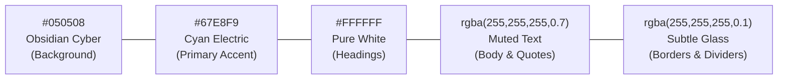
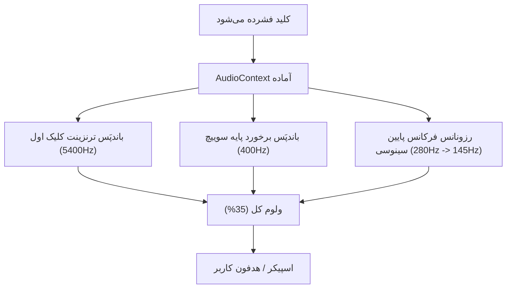

# 🎨 مستند جامع طراحی و دیزاین سیستم استودیو راک (Rock Studio Design System)

> **نسخه دیزاین:** `1.0.0`  
> **هویت بصری:** سایبرپانک مینیمال، هایپرفلوئید، سینماتیک و تاریک (Obsidian Cyber & Cyan Electric)  
> **مخزن و کدبیس:** React 19 + Tailwind CSS + Framer Motion + Web Audio API

---

## فهرست مطالب
1. [فلسفه و کانسپت طراحی (Design Philosophy)](#1-فلسفه-و-کانسپت-طراحی)
2. [پالت رنگی و توکن‌ها (Color Tokens)](#2-پالت-رنگی-و-توکنها)
3. [تایپوگرافی و مقیاس متون (Typography & Hierarchy)](#3-تایپوگرافی-و-مقیاس-متون)
4. [زبان حرکتی و فیزیک انیمیشن‌ها (Motion & Physics Language)](#4-زبان-حرکتی-و-فیزیک-انیمیشنها)
5. [طراحی لایه‌های پس‌زمینه و اتمسفر (Atmospheric Effects)](#5-طراحی-لایه‌های-پسزمینه-و-اتمسفر)
6. [کالبدشکافی و دیزاین کامپوننت‌ها (Component Specifications)](#6-کالبدشکافی-و-دیزاین-کامپوننتها)
   - [۶.۱. نوبار و منوی ناوبری (Navbar & Drawer)](#۶۱-نوبار-و-منوی-ناوبری)
   - [۶.۲. بخش هیرو و تایتل واگرا (Hero & ScatterLetter)](#۶۲-بخش-هیرو-و-تایتل-واگرا)
   - [۶.۳. بیانیه و متن محوشونده (Statement Dissolve)](#۶۳-بیانیه-و-متن-محوشونده)
   - [۶.۴. داستان ما و هایلایت هم‌بنیان‌گذاران (Our Story Spotlight)](#۶۴-داستان-ما-و-هایلایت-همبنیانگذاران)
   - [۶.۵. دیوار سه‌بعدی پروژه‌ها (3D DriftWall & PortalNav)](#۶۵-دیوار-سهبعدی-پروژهها)
   - [۶.۶. کیبورد مکانیکی و فرم تماس (3D Mechanical Keyboard & Form)](#۶۶-کیبورد-مکانیکی-و-فرم-تماس)
   - [۶.۷. صفحه اختصاصی پروژه (Case Study & Bento Grid)](#۶۷-صفحه-اختصاصی-پروژه)
7. [دیزاین صوتی (Sound Design & Audio Physics)](#7-دیزاین-صوتی)
8. [استانداردها و پایپ‌لاین مدیا و است‌ها (Asset Pipeline)](#8-استانداردها-و-پایپلاین-مدیا-و-استها)
9. [طراحی ریسپانسیو و بریک‌پوینت‌ها (Responsive Breakpoints)](#9-طراحی-ریسپانسیو-و-بریکپوینتها)

---

## ۱. فلسفه و کانسپت طراحی

طراحی استودیو راک بر پایه **«تلاقی سینما، مهندسی خلاقانه و ریتم فیزیکی»** بنا شده است. برخلاف وب‌سایت‌های تخت و معمولی شرکتی، راک تجربه‌ای شبیه به رابط‌های کاربری آینده‌نگرانه (Futuristic HUD)، استودیوهای تولید فیلم سینمایی و فضاهای نرم‌افزاری اختصاصی اپل و سایبرپانک ارائه می‌دهد.

### اصول محوری دیزاین:
- **تاریکی عمیق (Obsidian Canvas):** پس‌زمینه‌ای به عمق فضا (`#050508`) که چشم را خسته نمی‌کند و اجازه می‌دهد رنگ‌های نورانی و هایلایت‌ها جلوه کنند.
- **انرژی الکتریکی فیروزه‌ای (Cyan Pulse):** رنگ شاخص `#67E8F9` نماد جرقه خلاقیت، اتصال منطقی و آینده است.
- **فیزیک اسپرینگ و اصطکاک طبیعی:** هیچ المانی به صورت خشک و خطی حرکت نمی‌کند؛ تمام انیمیشن‌ها اینرسی، شتاب و توقف ارگانیک دارند.
- **بازخورد لمسی و شنیداری چندحسی (Multi-Sensory):** تلفیق انیمیشن ریپل نوری و تولید صدای واقعی سوییچ‌های مکانیکی با وب‌اودیو.

---

## ۲. پالت رنگی و توکن‌ها

تمام رنگ‌ها در فایل متمرکز `src/lib/constants.js` قرار دارند:



| نام توکن | کد هگز / مقدار | شفافیت | کاربرد اصلی |
| :--- | :--- | :--- | :--- |
| **Primary (Cyan)** | `#67E8F9` | `100%` | لینک‌های فعال، نقاط فوکوس، بوردرهای Spotlight، دکمه‌های اکشن |
| **Primary Glow** | `rgba(103, 232, 249, 0.15)` | `15%` | هاله‌های شعاعی (Radial Glow) پشت سکشن‌ها و دکمه‌ها |
| **Background** | `#050508` | `100%` | پس‌زمینه سراسری صفحه و پایه‌های گرید |
| **Surface Dark** | `#080812` / `#101018` | `100%` | پنل‌های شیشه‌ای، کلیدهای کیبورد و کارت‌های بنتو |
| **Text Bright** | `#FFFFFF` | `100%` | تیترهای اصلی، تگ‌های H1/H2، نام بنیان‌گذاران |
| **Text Muted** | `rgba(255, 255, 255, 0.70)` | `70%` | متن پاراگراف‌ها، بیانیه‌ها و توضیحات کیس‌استادی |
| **Text Dim** | `rgba(255, 255, 255, 0.40)` | `40%` | لیبل‌های تک‌کلمه‌ای، تاریخ، کلاینت و شماره‌های فنی |
| **Border Glass** | `rgba(255, 255, 255, 0.10)` | `10%` | حاشیه‌های المان‌ها، گرید Bento و کارت‌های پروژه |

---

## ۳. تایپوگرافی و مقیاس متون

سیستم تایپوگرافی بر مبنای ترکیبی از **Sans-Serif دقیق مهندسی** و **Monospace فنی** شکل گرفته است:

- **فونت اصلی عنوان و متون:** `Inter, system-ui, -apple-system, sans-serif`
- **فونت کدهای فنی، لیبل‌ها و متاداده:** `ui-monospace, SFMono-Regular, Menlo, monospace`

### مقیاس واکنش‌گرا (Fluid Scale):

```css
/* تیترهای بزرگ هیرو */
font-size: clamp(2.5rem, 8vw, 6.5rem);
letter-spacing: -0.04em;
line-height: 0.95;

/* تیترهای سکشن‌ها */
font-size: clamp(1.85rem, 5vw, 3.75rem);
letter-spacing: -0.03em;
line-height: 1.05;

/* لیبل‌های مونو و تگ‌های بالاسری (Eyebrow) */
font-size: clamp(10px, 1.2vw, 12px);
letter-spacing: 0.25em ~ 0.3em;
text-transform: uppercase;
```

---

## ۴. زبان حرکتی و فیزیک انیمیشن‌ها

در دیزاین سیستم استودیو راک از دو منحنی شتاب کلیدی استفاده می‌شود:

### ۱. منحنی Expo-Out (`EASINGS.expoOut`):
`cubic-bezier(0.16, 1, 0.3, 1)`  
- **احساس:** ورود بسیار سریع و توقف بی‌نهایت نرم و ابریشمی.
- **کاربرد:** باز شدن دراور منو، ترنزیشن زوم تمام‌صفحه پروژه‌ها، شناور شدن کارت‌های پیش‌نمایش.

### ۲. منحنی سینماتیک (`EASINGS.cinematic`):
`cubic-bezier(0.22, 1, 0.36, 1)`  
- **احساس:** ایجاد عمق، تأخیر وزین شبیه حرکت دوربین‌های هالیوودی.
- **کاربرد:** انیمیشن تا شدن سه‌بعدی کیبورد مکانیکی و اسکرول فوتوگرافی داستان تیم.

### ۳. پارامترهای اسپرینگ (Spring Physics):
```javascript
{
  stiffness: 70,     // سفتی فنر (کاهش ضربه تند)
  damping: 24,       // میرایی (خنثی کردن نوسان اضافه)
  mass: 0.5,         // جرم المان (حس سبکی و پاسخ‌دهی بالا)
  restDelta: 0.0001
}
```

---

## ۵. طراحی لایه‌های پس‌زمینه و اتمسفر

اتمسفر سایت تک‌لایه نیست؛ از ۳ لایه ترکیبی تشکیل شده تا حس فضایی زنده (Living Digital Space) را منتقل کند:

1. **لایه عمیق ذرات (`DataRain.jsx`):**
   - باران داده دیجیتال با رنگ فیروزه‌ای ملایم و حرکت عمودی پیوسته در عمق `-z-50`.
   - **چگالی متغیر بر اساس دستگاه:** ۳۲۰ ذره روی موبایل (جهت بهینه‌سازی باتری و GPU) و ۷۵۰ ذره روی دسکتاپ.
2. **لایه‌های درخشش شعاعی (Ambient Radial Gradients):**
   - ایجاد گرادیان‌های کانونی با شعاع بزرگ و شفافیت کم (`rgba(103, 232, 249, 0.08)`) در مرکز دید کاربر.
3. **لایه محتوای شناور (Isolate Surface):**
   - محتوا در لایه `z-10` قرار دارد تا ذرات به زیبایی از پشت شیشه‌های بلور شده (Backdrop Blur) محو به نظر برسند.

---

## ۶. کالبدشکافی و دیزاین کامپوننت‌ها

### ۶.۱. نوبار و منوی ناوبری
- **وضعیت پیش‌فرض:** چسبیده (Sticky)، دارای حاشیه شیشه‌ای `border-b border-white/10` با بلور زمینه `backdrop-blur-md`.
- **نقطه پالس راک:** یک نقطه نوری فیروزه‌ای کوچک با انیمیشن `animate-pulse` در کنار لوگوی ROK که نشان‌دهنده فعالیت زنده استودیو است.
- **حالت موبایل:** تبدیل به آیکون مدرن همبرگر و پنل تمام‌صفحه با افکت شیشه‌ای مشکی و اسکرول قفل شده.

### ۶.۲. بخش هیرو و تایتل واگرا
- **الگوریتم واگرایی حروف (`ScatterLetter`):**
  - حروف با توجه به مکان و شدت اسکرول در راستای سه محور X، Y و چرخش Z پراکنده می‌شوند:
  ```javascript
  transform: `translate3d(${dx}px, ${dy}px, 0) rotate(${rot}deg)`
  ```
- **سوییپر کلمات کلیدی (`TechText`):**
  - کلمات کلیدی نقش‌های استودیو با افکت نوری سایبری و فید شبیه کد گیت در بالای تایتل جابجا می‌شوند.

### ۶.۳. بیانیه و متن محوشونده (`Statement`)
- متنی پرمعنا با اندازه بزرگ که کلمه به کلمه و کاراکتر به کاراکتر با اسکرول کاربر از شفافیت `0.1` به `1` رسیده و پس از عبور از وسط صفحه، به صورت ذره‌ای حل (Dissolve) می‌شود.

### ۶.۴. داستان ما و هایلایت هم‌بنیان‌گذاران (`OurStory`)
- عکاسی آنالوگ با کیفیت بالا از ۳ بنیان‌گذار استودیو (نیما، پارسا، سامان).
- **مختصات اسپات‌لایت (`src/data/founders.js`):**
  - با اسکرول صفحه، یک کادر نوری نئونی فیروزه‌ای به همراه عکس پرتره فوکوس شده روی چهره بنیان‌گذار ظاهر می‌شود در حالی که بقیه عکس تاریک می‌گردد.
  - کارت نقل‌قول، نقش تخصصی و تگ‌های مهارتی همزمان از کنار وارد صفحه می‌شوند.

### ۶.۵. دیوار سه‌بعدی پروژه‌ها (`DriftWall` & `ProjectPortalNav`)
- **ساختار سه‌بعدی:** کاشی‌های شناور در فضای سه‌بعدی با زاویه دید `perspective(1000px)`.
- **آرایش واکنش‌گرا:**
  - **موبایل:** ۳ ستون با فاصله کم و تایپوگرافی خوانا.
  - **دسکتاپ:** ۵ ستون شناور با قابلیت پیش‌نمایش ویدیویی هاور.
- **ناوبری پرتال شناور گوشه صفحه (`ProjectPortalNav`):**
  - **روی دسکتاپ:** هاور روی Next/Prev کارت پیش‌نمایش پرتال را باز می‌کند؛ کلیک سریع هدایت می‌کند.
  - **روی موبایل:** لمس و رها کردن سریع (زیر ۶۰۰ میلی‌ثانیه بدون درگ) بلافاصله جابجا می‌شود؛ نگه داشتن انگشت به مدت **۲ ثانیه کامل** کارت پیش‌نمایش را نشان می‌دهد تا هنگام اسکرول عادی دست کاربر ناخواسته مانع دید نشود.

### ۶.۶. کیبورد مکانیکی و فرم تماس (`Contact`)
- **چیدمان ۷۵٪ مکینتاش:** کلیدهای طراحی شده با سایه‌های چندمرحله‌ای (Inset Box-Shadows) شبیه به سوییچ‌های واقعی Cherry MX / Apple Magic Keyboard.
- **انیمیشن ضربه (Key Depression):** فرورفتگی `translateY(1.5px)` به همراه روشن شدن حروف به رنگ فیروزه‌ای.
- **موج نوری (Radial Ripple):** ایجاد دایره‌های نوری فیروزه‌ای هم‌مرکز در محل ضربه کلید و محو شدن تدریجی با انیمیشن `cubic-bezier(.2,.8,.2,1)`.
- **فرم لید:** ورودی‌های خطی مینیمال با فیلتر هوشمند اعداد فارسی و انگلیسی.

### ۶.۷. صفحه اختصاصی پروژه (`ProjectDetail`)
- **ترنزیشن زوم تمام‌صفحه:** هنگام کلیک روی یک پروژه، کل صفحه از مختصات دقیق کلیک با منحنی اکسپوننشیال بزرگ شده و روی صفحه می‌نشیند.
- **شبکه متاداده بنتو (Bento Metadata):** چهار خانه شامل کارفرما، سال تولید، حوزه دیزاین و نوع خروجی با بوردرهای شیشه‌ای ظریف.
- **پلیر ویدیوی سفارشی:** نوار پیشرفت seekable با گرادیان فیروزه‌ای، شمارنده زمان استاندارد، کنترل میوت و تمام‌صفحه.

---

## ۷. دیزاین صوتی (Sound Design & Audio Physics)

سیستم تماس راک استودیو دارای یک موتور اختصاصی سنتز صدا با استفاده از **Web Audio API** مرورگر است (بدون نیاز به دانلود فایل‌های صوتی سنگین mp3/wav):



### پروفایل‌های صوتی تفکیک شده:
- **Normal Keys:** صدای ترد با فرکانس مرکزی ۵۴۰۰ هرتز و ضربه پایه ۴۰۰ هرتز.
- **Spacebar:** صدای بم‌تر و عمیق‌تر با فرکانس ۲۲۰۰ هرتز و بدنه ۱۴۸ هرتز.
- **Enter:** صدای قاطع و زنگ‌دار با فرکانس ۳۷۰۰ هرتز.
- **Delete / Backspace:** کلیک خشک و سریع با فرکانس ۶۱۰۰ هرتز.
- **Modifiers (Shift/Cmd/Opt):** صدای نرم و نامحسوس با ۳۰۰۰ هرتز.

---

## ۸. استانداردها و پایپ‌لاین مدیا و است‌ها

برای دستیابی به حداکثر سرعت بارگذاری و نمره پرفورمنس ۱۰۰ در Lighthouse:

1. **تصاویر با فرمت مدرن WebP:**
   - تمام تصاویر فشرده شده با `cwebp / sharp` با کیفیت ۸۵٪.
   - اندازه هر تصویر از ۶ تا ۷ مگابایت به کمتر از ۶۰ تا ۲۰۰ کیلوبایت (کاهش بیش از ۹۲٪ حجم کل).
2. **کاشی‌های اسکرول سبک (`-scroll.webp`):**
   - تصاویر دیواره متحرک به عرض بهینه ۷۰۰ پیکسل محدود شده‌اند تا حافظه رم و گرافیک درگیر رندرهای بیهوده نشود.
3. **کش دائم در شبکه CDN (`vercel.json`):**
   - تمام است‌های موجود در `assets/` با هدر `Cache-Control: public, max-age=31536000, immutable` کش می‌شوند.

---

## ۹. طراحی ریسپانسیو و بریک‌پوینت‌ها

| دستگاه | عرض صفحه | ویژگی‌های اختصاصی طراحی |
| :--- | :--- | :--- |
| **Mobile** | `< 768px` | ستون‌های ۳تایی دیواره، تراکم ذرات ۳۲۰، دراور تمام‌صفحه منو، هولد ۲ ثانیه‌ای پیش‌نمایش پرتال |
| **Tablet** | `768px - 1024px` | ستون‌های ۴تایی، بنتو گرید ۲ در ۲، فونت‌های سایز متوسط |
| **Desktop** | `> 1024px` | کیبورد سه‌بعدی با زاویه پرسپکتیو، دیوار ۵ ستونه، هاور کلیپ‌های ویدیویی، ذرات ۷۵۰ |

---

> این سند به عنوان راهنمای استاندارد طراحی و هویت بصری استودیو راک در ریشه پروژه قرار دارد تا تمامی توسعه‌ها، صفحات و کامپوننت‌های آینده بر اساس همین هماهنگی و زیبایی خلق شوند.
